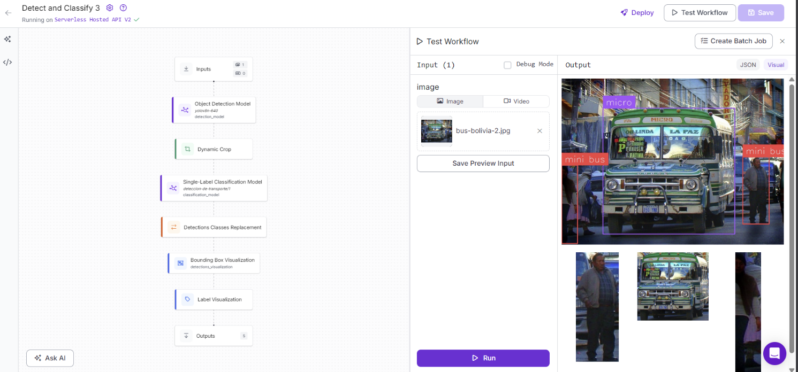
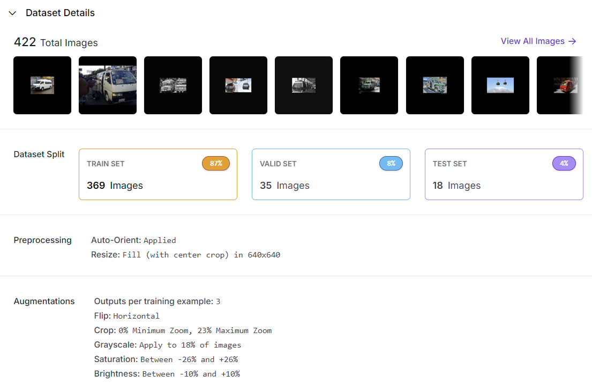
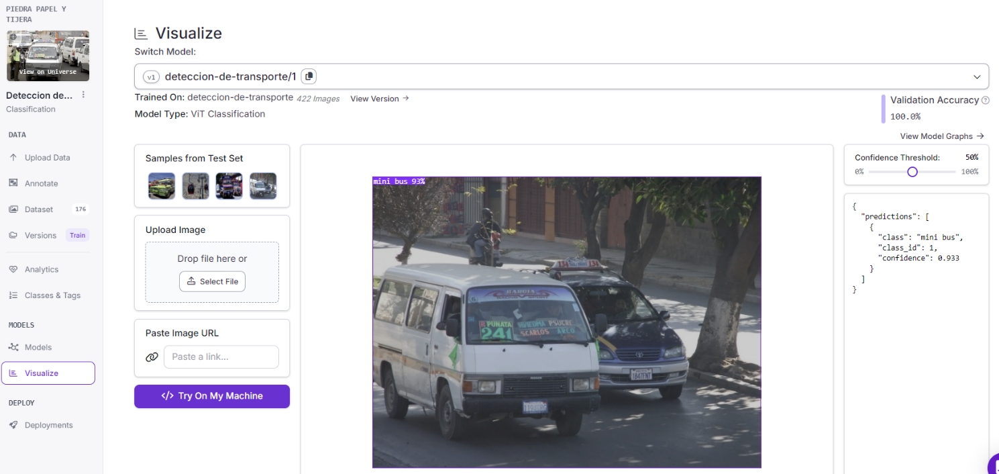

# Clasificación de transporte público en imágenes

¿Puede un modelo distinguir micros, minibuses y teleféricos en fotografías de transporte boliviano? En este trabajo final del módulo de Fundamentos de Cloud Computing del diplomado de la UPB reuní y etiqueté 176 imágenes, preparé una versión de 422 archivos en Roboflow y probé un clasificador de tres clases. El proyecto muestra el conjunto de datos, el modelo alojado en Roboflow y un flujo de detección y clasificación; sus resultados deben interpretarse según el tamaño de la validación disponible.

## Problema

El objetivo académico fue reconocer tres tipos de transporte en fotografías: **micro**, **mini bus** y **teleférico**. La pregunta práctica es si el clasificador identifica esas clases en ejemplos nuevos y qué evidencia haría falta antes de usarlo fuera de la actividad.

## Datos

El experimento utilizó **176 imágenes originales** reunidas para el proyecto, incluidas imágenes obtenidas de internet: 63 de micro, 53 de minibús y 60 de teleférico. La [versión 1 del proyecto en Roboflow Universe](https://universe.roboflow.com/piedra-papel-y-tijera-wtgoh/deteccion-de-transporte) muestra las tres clases y ofrece el modelo público. La [nota de datos](data/README.md) distingue esa versión de 422 imágenes del archivo descargable de 418.

| Partición | Imágenes originales | Archivos de la versión exportada |
| --- | ---: | ---: |
| Entrenamiento | 123 | 369 |
| Validación | 35 | 35 |
| Prueba | 18 | 18 |

La división original fue aproximadamente **70/20/10**. Roboflow generó tres versiones de cada imagen de entrenamiento (123 × 3 = 369); validación y prueba no se aumentaron. Por eso, al contar los **422 archivos exportados**, los porcentajes visibles pasan a 87/8/4. Las cifras usan denominadores distintos.

## Mi contribución

Realicé este trabajo de forma individual: recopilé las imágenes, las organicé y etiqueté en tres clases, configuré la partición y los aumentos en Roboflow, entrené el clasificador ViT y preparé el workflow de detección, recorte y clasificación. El detector YOLOv8 se utilizó como componente del workflow; no se documenta un entrenamiento específico de ese detector.

## Método

1. Reunir y etiquetar fotografías de las tres clases.
2. Separar 123 imágenes originales para entrenamiento, 35 para validación y 18 para prueba; aplicar orientación automática, ajuste de tamaño y aumentos solo a entrenamiento.
3. Entrenar el modelo de **clasificación ViT** que figura en Roboflow Universe. Probarlo en la interfaz de modelos.
4. Integrar ese clasificador en un workflow que usa primero un **detector YOLOv8**, recorta las detecciones y clasifica cada recorte.

## Resultados

- Roboflow muestra **100 % de exactitud de validación** para el clasificador ViT. La partición de validación contiene 35 imágenes; este número no es una medición independiente del conjunto de prueba.
- En una imagen de ejemplo con otro vehículo cercano, el clasificador asignó **93,3 % de confianza** a la clase «mini bus». Esa confianza es de una predicción individual, no una exactitud global.
- El workflow etiquetó el micro de una fotografía, pero también asignó «mini bus» a recortes de personas. La captura sirve para mostrar el flujo y uno de sus errores visibles; no hay una evaluación cuantitativa del detector ni del workflow completo.

## Conclusión y límites

El proyecto demuestra la preparación de un conjunto pequeño, entrenamiento de un clasificador alojado y composición de un flujo de inferencia. El **100 % de validación no permite afirmar que el sistema generalice** a otras ciudades, condiciones de luz o ángulos. El conjunto de prueba tiene solo 18 imágenes —3 de minibús— y no se conserva una métrica de prueba comprobada. El error visible en el workflow también muestra que la exactitud del clasificador no mide por sí sola la calidad de las detecciones. Para una evaluación más sólida harían falta fotografías nuevas, un conjunto de prueba mayor y métricas por clase del clasificador y del detector.

## Aprendizajes

Aprendí a distinguir la división de imágenes originales del número de archivos después del aumento de datos, y a separar la exactitud de validación de la confianza de una predicción. Si repitiera el proyecto, documentaría mejor la procedencia de cada foto y evaluaría por separado el detector, el clasificador y el workflow con imágenes nuevas.

## Habilidades técnicas utilizadas

- **Preparación de imágenes:** recopilación, etiquetado, partición y aumento en Roboflow.
- **Visión por computadora:** entrenamiento de un clasificador ViT y uso de detección y recorte antes de la clasificación en un workflow.
- **Evaluación:** lectura de exactitud de validación, confianza de inferencia y límites de un conjunto de prueba pequeño.

## Explorar el caso

- [Abrir el proyecto y modelo público en Roboflow](https://universe.roboflow.com/piedra-papel-y-tijera-wtgoh/deteccion-de-transporte).
- [Consultar la descripción de los datos](data/README.md).

El entrenamiento y el workflow se configuraron en la interfaz de Roboflow. El modelo y el conjunto preparado se consultan en el proyecto alojado. El archivo descargable contiene un subconjunto de imágenes preparadas que **no reproduce exactamente** el entrenamiento ni la validación de la versión 1; el repositorio no contiene los pesos del modelo ni una ejecución local del entrenamiento.
